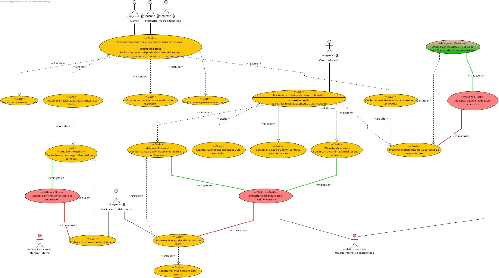

Concepto de Operaciones (ConOps)

| Grupo | LeftJoiners |
| ---| --- |
| Proyecto | Sistema de Detección Temprana de Acoso Escolar y Abandono Escolar |

**Historial de Cambios**

| Versión | Fecha | Secciones Modificadas | Descripción | Responsable |
| ---| ---| ---| ---| --- |
| 1 | 05/10 | 1 a la 6 | Realización del documento | Paula, Dani, Alfonso y María |
|  |  |  |  |  |
|  |  |  |  |  |

# **1\. Introducción y contexto**
## **1.1. Origen** 
El origen de esta iniciativa responde a la identificación de tres deficiencias fundamentales en los mecanismos  de detección de _bullying_:
*   **Ausencia de un medio de comunicación confidencial y accesible:** Los miembros de la comunidad educativa (familias, alumnado y profesorado) carecen de un canal directo para transmitir inquietudes o indicios tempranos de intimidación, condicionados con frecuencia por el temor o la incertidumbre sobre el procedimiento antes de formalizar una denuncia.
*   **Enfoque estrictamente burocrático de PASEN:** En la actualidad, el uso del sistema se reduce al seguimiento de calificaciones, faltas de asistencia y avisos informativos, desaprovechando su implantación para proporcionar orientación activa e interactiva.
*   **Infrautilización de precedentes resueltos:** El historial recopilado por los centros tras gestionar situaciones precedentes permanece almacenado de manera estática y aislada. Se carece de una herramienta capaz de analizar dicho histórico de forma anonimizada y ponerlo en relación con variables contextuales (como el rendimiento escolar o el absentismo) para anticipar escenarios de riesgo.
Ante este escenario, la propuesta plantea la incorporación en PASEN de un módulo de asistencia inteligente diseñado para capitalizar el conocimiento previo, transformándolo en un instrumento de consulta preventiva y de ayuda a la toma de decisiones para los equipos directivos y de orientación.
## **1.2. Motivación**
La motivación principal del proyecto se fundamenta en dotar a los centros educativos de una herramienta de prevención activa, centrada en el bienestar del menor y en el respaldo al equipo docente.
*   **Fomentar la detección temprana:** Reducir el tiempo que transcurre entre las primeras señales de malestar y la intervención del centro, facilitando un entorno accesible y confidencial donde consultar sin miedo al juicio.
*   **Proporcionar orientación inmediata y no invasiva:** Ofrecer respuestas claras basadas en pautas de actuación aprobadas, ayudando a las familias y al alumnado a comprender la situación antes de que escale.
*   **Transformar la experiencia previa en prevención:** Construir un sistema de apoyo a la toma de decisiones para los equipos de orientación que, mediante el análisis ético y anonimizado de datos contextuales (asistencia, rendimiento y dinámicas grupales), permita anticipar escenarios de riesgo basándose en intervenciones pasadas eficaces.
*   **Garantizar la protección y la ética digital:** Asegurar que el uso de tecnologías basadas en datos e inteligencia artificial se aplique bajo el cumplimiento riguroso de la privacidad de los menores, priorizando en todo momento la mediación humana.

## **1.3. Equipo**
*   Paula Jiménez Fernández
*   Daniel Robles Cantos
*   Javier Urbaneja Benítez
*   Marina Fernández
*   Andrea Rodríguez Pérez
*   María Muñoz Martín
*   Antonio Martín García
*   Alfonso Ramos Rojas
# **2\. Propósito del Sistema**
El propósito del sistema es desarrollar un módulo inteligente de detección temprana, orientación y apoyo ante situaciones de acoso escolar, concebido para su integración en la plataforma de comunicación educativa PASEN.
El software tiene como finalidad principal proporcionar a la comunidad educativa (docentes, alumnado y familias) un canal confidencial y accesible para comunicar dudas, inquietudes ante posibles situaciones de acoso. A través de una interfaz conversacional asistida por Inteligencia Artificial, el sistema ofrece una primera orientación contextualizada y adaptada a los protocolos del centro educativo.
Asimismo, el sistema incorpora un mecanismo de aprendizaje y contraste basado en casos históricos confirmados y resueltos por el centro. Mediante el cruce y análisis contextual de variables académicas y de convivencia (asistencia, rendimiento y dinámicas de grupo) y garantizando en todo momento la estricta anonimización y protección de datos sensibles, el software busca identificar patrones de riesgo. Después, propone al equipo directivo y orientador medidas preventivas e intervenciones basadas en experiencias previas exitosas.
Con ello, el sistema pretende actuar como una herramienta de apoyo preventivo y de toma de decisiones para los equipos de orientación y mediación escolar, optimizando los tiempos de detección y respuesta frente al acoso.
# **3\. Definiciones**
**PASEN:** Aplicación y portal web dependiente de la Consejería de Desarrollo Educativo de la Junta de Andalucía, diseñado como canal de comunicación telemática entre los centros educativos, el profesorado, el alumnado y sus tutores legales.
**Séneca:** Sistema integral de gestión de la Junta de Andalucía que centraliza la administración académica, documental y disciplinaria de los centros educativos no universitarios.
**Acoso escolar:** Conducta reiterada de violencia física, verbal o psicológica ejercida de forma sistemática e intencionada por uno o varios alumnos hacia otro en una relación de desequilibrio de poder.
**Caso confirmado:** Registro formal validado por el equipo directivo y el departamento de orientación del centro educativo donde se determina, tras la aplicación del protocolo oficial, que los hechos investigados corresponden a una situación acreditada de conflicto grave o acoso.
**Variables contextuales (o académicas):** Conjunto de métricas e indicadores individuales del alumno ya registrados en el sistema, tales como porcentaje de absentismo escolar, evolución de calificaciones académicas y dinámica de grupo, utilizables como señales indirectas de alerta.
**Anonimización:** Proceso irreversible de disociación de la información por el cual un conjunto de datos deja de estar vinculado a una persona física identificada o identificable, garantizando el estricto cumplimiento del Reglamento General de Protección de Datos (RGPD) y la protección de datos de menores.
**Patrón de coincidencia:** Relación de similitud estadística o semántica detectada por el sistema entre una consulta en curso y los rasgos característicos de uno o más casos históricos previamente cerrados y resueltos.
**Módulo conversacional (Chatbot asistido):** Componente software basado en procesamiento del lenguaje natural (PLN) que interactúa con el usuario para clasificar la consulta, recopilar detalles preliminares y proporcionar orientación protocolizada.

# **4\. Análisis de Partes y Objetivos**
## **4.1. Partes implicadas**
*   **Alumnado:** utiliza el chat para contar situaciones que le preocupan y pedir orientación.
*   **Familias y tutores legales:** consultan dudas y comunican cambios que observan en el alumno.
*   **Profesorado:** aporta observaciones sobre el aula y consulta cómo actuar ante posibles indicios de acoso.
*   **Centro educativo y responsable de convivencia:** revisan las situaciones, confirman los casos y deciden las actuaciones. Aportan al historial los casos confirmados y, de forma opcional, las medidas aplicadas y sus resultados.
*   **Administrador del sistema:** mantiene la aplicación asegurándose que no hay brechas de seguridad donde se filtren la información del alumnado y de los casos.
*   **Atacante externo:** son agentes maliciosos externos a la aplicación que intentan vulnerar los datos de los alumnos y los casos.
*   **Usuario interno malintencionado: Agentes  maliciosos con acceso interno a la aplicación que quieren acceder a datos y recursos a los cuales no tienen permiso**
## **4.2. Diagrama Tropos**

## **4.3. Relaciones entre objetivos**
El objetivo más principal es obtener orientación ante una situación de acoso. Este objetivo lo tienen tanto alumnos, padre, madre o tutores legales, y profesores. Este mismo objetivo se extiende en los objetivos de recibir orientación basada en el contexto concreto del alumno y en obtener orientación basada en información de casos anteriores.
Este objetivo principal incluye los objetivos de poder comunicar la situación, comprobar si existen casos confirmados relevantes, y recibir pautas generales de actuación.
Sobre recibir orientación basada en el contexto del alumno incluye el controlar el acceso a los datos de los alumnos según identidad, rol y permisos. El cual a su vez incluye el de proteger la información del alumnado el cual es un objetivo del administrador  del sistema.
Otro objetivo común muy grande es mantener un historial de casos confirmados, el cual incluye conservar la descripción y el contexto relevante de cada caso, registrar las medidas adoptadas sobre el caso, contar con la confirmación del caso por parte del centro y preservar el anonimato de casos anteriores. Un objetivo que extiende este es el de registrar las medidas adoptadas en un caso y sus resultados.
## **4.4. Criterios de aceptación y compromisos**
Se proponen los siguientes criterios para comprobar el funcionamiento del prototipo con usuarios y casos de prueba:
*   **Acceso según el rol:** alumnado, familias y profesorado pueden consultar el chat con sus permisos. Una petición de información fuera de esos permisos se rechaza sin mostrar datos ajenos.
*   **Orientación sin antecedentes:** ante una consulta sin casos similares, el chat ofrece pautas generales adaptadas al relato.
*   **Comparación con antecedentes:** ante un caso de prueba similar a otro confirmado, el módulo ofrece recomendaciones relacionadas con ese precedente, explica su carácter orientativo y no revela la identidad de terceros.
*   **Historial validado:** solo un responsable autorizado del centro puede confirmar un caso para su incorporación. Un relato sin confirmar no se añade al historial reutilizable como caso confirmado.
*   **Anonimización:** antes de reutilizar un caso, se eliminan sus identificadores y se revisan los detalles que puedan permitir reconocer a las personas. Las pruebas deben comprobar que las respuestas no exponen esa información.
*   **Resultados opcionales:** el sistema admite casos sin medidas o resultados registrados y distingue entre una medida aplicada y una medida con resultado favorable conocido.
*   **Claridad y utilidad:** las respuestas emplean lenguaje comprensible para cada tipo de usuario y proponen pasos concretos. Su pertinencia se revisará con ejemplos de consultas de alumnado, familias y profesorado.
Como compromisos de uso, alumnado, familias y profesorado aportarán información con la mayor precisión posible y utilizarán el chat como apoyo para consultar dudas. El centro mantendrá la responsabilidad de confirmar los casos, revisar las recomendaciones y decidir las actuaciones, además de actualizar el historial cuando disponga de nueva información.
El equipo de desarrollo se encargará de aplicar los permisos, preparar la anonimización y comprobar los criterios anteriores con datos ficticios en el prototipo. La integración con PASEN dependerá del acceso autorizado a sus servicios.
# **5\. Alcance del Sistema**
## **5.1. Identificación de Productos Software**
El sistema se estructurará como una extensión o módulo del sistema Séneca PASEN. Tendrá los siguientes artefactos o servicios:
**Modulo de Cliente (Plug-in o add-on de PASEN):** Componente para la interfaz de usuario en las aplicaciones web y móvil de PASEN. Proporciona el punto de acceso a un canal de conversación seguro para docentes, tutores legales y alumnado.
**Chatbot Multi-Rol:** Módulo de diálogo y procesamiento de lenguaje natural capaz de atender consultas, interpretar situaciones de acoso o malestar de los alumnos y ofrecer orientación según el contexto. Con control de contexto y acceso a los registros del alumno según el rol de quién se conecta.
**Servicio de almacenamiento de información académica y de comportamiento/patrones:** Servicio en segundo plano que extrae e indexa de forma continua los datos estructurales del alumnado desde PASEN (calificaciones, absentismo, partes de convivencia, observaciones y dinámicas de grupo).
**Motor basado en el “feedback” y correspondencia de casos:** Motor de razonamiento y recuperación basado en casos previos. Contrasta conversaciones con un repositorio de casos confirmados por el centro, identificando patrones comunes y sugiriendo protocolos o medidas que ya resultaron efectivas.
**Motor de automatización y registro de casos:** Servicio de control de casos, donde el equipo docente y de orientación valida los casos confirmados y registra las soluciones aplicadas, siempre asegurando el anonimato del estudiante antes de introducir nada a la base de datos.
**Pasarela de alertas y notificaciones:** Servicio encargado de mandar notificaciones automáticas y alertas a los perfiles de orientación y profesorado cuando el módulo conversacional o el motor de patrones detecta indicadores de posible acoso o problema del alumnado.

## **5.2 Priorización MoSCoW**
### 5.2.1. Must Have (Obligatorio para la versión que se lance)
*   **Integración nativa del módulo en el entorno PASEN:** Despliegue de la interfaz directamente accesible tras la autenticación estándar de la plataforma educativa.
*   **Chat interactivo según el perfil (Alumnos, Familias y Docentes):**
*   _Alumnado:_ Canal seguro y accesible para comunicar situaciones de malestar, aislamiento o acoso.
*   _Padres/Tutores:_ Asistente para resolver dudas sobre cambios de comportamiento y vías oficiales de actuación.
*   _Profesorado:_ Asistente técnico-pedagógico para evaluar indicios y consultar protocolos de actuación del centro.
*   **Contextualización de respuestas mediante datos de PASEN:** Capacidad del chatbot para contrastar la conversación con el historial de asistencia, notas y observaciones del alumno implicado (respetando siempre los permisos de acceso de cada rol).
*   **Detección de emergencias y escalado automático:** Clasificación de mensajes para identificar situaciones de riesgo inminente y alertar de inmediato a los tutores u orientadores del centro.
*   **Validación y cierre formal de casos por el centro:** Funcionalidad para que el equipo orientador/docente confirme si un caso sospechoso acabó siendo un caso real de acoso/abandono y registre formalmente la incidencia.
*   **Módulo de anonimización obligatoria:** Protocolo criptográfico y de disociación de identificadores directos e indirectos antes de almacenar cualquier expediente en la base de datos del sistema.
### 5.2.2. Should Have (Importante, pero no es necesario para el primer lanzamiento)
*   **Motor de contraste y recomendación por casos análogos:** Algoritmo que compare la conversación e indicadores del alumno actual con la base de datos anónima para sugerir a los docentes pautas de intervención que hayan tenido éxito en casos similares.
*   **Registro de resoluciones de casos:** Formulario guiado para que los orientadores detallen qué medidas ayudaron a resolver el caso favorablemente.
*   **Panel de monitorización para el departamento de orientación:** Agrupar consultas para detectar patrones de manera anónima.
*   **Explicación al recomendar una medida:** Explicar a los docentes el por qué es recomendable una medida concreta según tasas de éxito anteriores en un caso similar.
### 5.2.3. Could Have (Sería bueno para el proyecto si tuviéramos tiempo y recursos)
*   **Soporte multilenguaje en el chat:** Traducción automática integrada para facilitar la comunicación con familias que no hablen español en el entorno PASEN.
*   **Borradores preparado al iniciar un protocolo:** Borrador estructurado del protocolo oficial de acoso escolar de la Junta de Andalucía a partir de los datos contrastados en el chat, ya listo para la firma del orientador.
*   **Guías y recursos multimedia descargables:** Envío en el propio chat de información y materiales de apoyo homologados adaptados a la consulta del menor o de la familia.
### 5.2.4. Won't Have (No se tendrá en un principio)
*   **Resolución automática o diagnóstico psicológico autónomo:** El chat actuará como herramienta de ayuda, nunca emitirá diagnósticos clínicos ni sustituirá las decisiones del equipo de orientación del centro.
*   **Toma de decisiones sin intervención humana:** Prohibición explícita de aplicar sanciones o medidas disciplinarias de manera automatizada.
*   **Cruce de datos entre casos de centros sin anonimizar:** No se podrá obtener datos de alumnos de otros centros para evitar filtraciones de información que no sea anónima.
*   **Monitorización de dispositivos personales o redes sociales externas:** El alcance quedará limitado a la plataforma PASEN, nunca accediendo a recursos externos.

# **6\. Descripción del producto**
## **6.1. Concepto del Nuevo Sistema**
El sistema consiste en un  módulo de asistencia inteligente plenamente integrado en el ecosistema PASEN, disponible en web y dispositivos móviles. Su propósito es sustituir la gestión puramente reactiva del conflicto por un canal de orientación  confidencial frente al acoso. Es destacable los siguientes puntos:
*   **Punto de acceso unificado:** Los usuarios se autentican con sus credenciales habituales de PASEN, accediendo a un canal conversacional seguro sin necesidad de instalar aplicaciones adicionales ni gestionar cuentas externas.
*   **Atención adaptada a cada rol:**
    *   **El alumnado cuenta con un canal empático donde comunicar situaciones de aislamiento o intimidación y recibir consejos inmediatos sobre cómo actuar.**
    *   **Las familias pueden plantear dudas ante cambios de conducta y conocer las vías oficiales de actuación del centro.**
    *   **El profesorado dispone de un recurso técnico-pedagógico para contrastar indicios observados en el aula y consultar los protocolos correspondientes.**
*   **Apoyo basado en contexto y precedentes:** El módulo analiza las consultas contrastándolas con variables académicas autorizadas (como absentismo o rendimiento) y con una base histórica de intervenciones previas eficaces. Con ello, detecta posibles patrones de riesgo y sugiere al personal orientador medidas de actuación basadas en experiencias reales del centro.
*   **Supervisión humana y detección de riesgo:** La inteligencia artificial actúa únicamente como asistente preventivo; no realiza diagnósticos clínicos ni impone medidas disciplinarias. Ante indicios de gravedad inminente, el sistema escala de inmediato la alerta a los responsables del centro, quienes conservan siempre la validación formal y el control de cualquier intervención.

## **6.2. Perspectiva del producto**
El sistema no es un producto independiente, es un módulo integrado dentro del ecosistema de PASEN. Este módulo aprovechará la infraestructura existente de autenticación, gestión de usuarios y bases de datos del sistema, añadiendo una capa de análisis, procesamiento del lenguaje y asistencia conversacional.
*   **Interfaces del sistema:** El módulo actuará directamente con el backend del sistema a través de APIs proporcionadas por la administración. Solicitará acceso de solo lectura para extraer el contexto del alumno como la asistencia o calificaciones, y permisos de escritura limitados para registrar casos confirmados en el historial del centro.
*   **Interfaces de usuario:** Al ser un módulo integrado, la interfaz gráfica debe respetar estrictamente el sistema de diseño, junto con sus paletas de colores, tipografías y estándares de accesibilidad. El usuario accederá a la herramienta conversacional a través de un nuevo botón o sección disponible dentro de la app, garantizando una experiencia de usuario fluida y sin fricciones, sin necesidad de descargar aplicaciones extras o de terceros.
*   Interfaces de hardware: El sistema no requiere de hardware específico, ya que opera sobre la infraestructura ya establecida de PASEN. Por parte del cliente, será compatible con cualquier dispositivo estándar capaz de ejecutar la aplicación móvil o la página web.
*   Interfaces de software: El módulo requerirá integración con motores de procesamiento de lenguaje natural para la interfaz conversacional y la detección del contexto. Además, se utilizará el sistema de base de datos del servidor para almacenar el histórico de casos
*   Interfaces de comunicaciones: Todas las comunicaciones entre el cliente, el módulo y las bases de datos se realizarán bajo protocolos de red seguros y cifrados, garantizando la confidencialidad de la información. Para el envío de alertas, se utilizará la pasarela de notificaciones push y de correos electrónicos, mostrándose de forma clara a los profesores al ser una situación sensible.
*   Memoria: dado que PASEN está adaptado para soportar cientos de miles de usuarios, los procesos de la IA no deben penalizar el rendimiento del sistema.
*   Operaciones: el sistema requiere operaciones de sincronización periódica. El chat funciona en tiempo real y el motor que busca patrones de abandono escolar cruzará los datos por lotes, ejecutados preferentemente en horario nocturno para no saturar el sistema.
*   Requisitos de adaptación o transición: Para la puesta en marcha, se requerirá de un despliegue por fases. Será necesaria una fase en el que se documentan casos reales e históricos para dotar el motor de IA con una base de conocimientos útil antes de su uso.

## **6.3. Tipos y Características de los Usuarios**
*   **Profesorado/Centro educativo**: Usuarios que pueden tener un nivel variable de conocimientos tecnológicos. Necesitan una interfaz clara para el fácil uso para todo tipo de profesorado, tanto con experiencia como sin ella. Además de informar de forma clara los posibles casos de acoso para actuar de forma rápida.
*   **Alumnos**: Gran conocimiento de las tecnologías, están habituados a su uso. Apenas deben percibir el sistema en el foro, que se sientan cómodos en usarlo libremente entre ellos y no generar su rechazo.
*   **Familias/Tutor legal**: Pueden tener diversas capacidades en el ámbito tecnológico, al igual que el profesorado. El sistema debe de ser fácil de usar y simple, que esté bien adaptado al sistema de PASEN que utilizan.
*   **Administrador del sistema**: Amplios conocimientos técnicos y fácil uso de la tecnología. Debe tener un sistema adaptado para la gestión de los usuarios, del acceso de los profesores y el control de los datos, que no se expongan en la interfaz del sistema.

## **6.4. Limitaciones**
*   **Políticas de regulación/Normativa**: Es necesario un cumplimiento de la ley de protección de datos, debido a la recopilación de los datos de los alumnos, la inferencia y tratamiento de estos, sobre todo al ser menores de edad.
*   **Seguridad y protecciones:**  Se debe suministrar el control de acceso por identidad, rol y permisos, para evitar así el acceso de atacantes externos. Por otro lado, también es importante la protección frente al usuario interno malintencionado, impidiendo que modifique casos fraudulentamente mediante autorías.
*   **Interfaces con otras aplicaciones**: La viabilidad de la incorporación con PASEN como un módulo interno dependerá de su permiso para la implementación y la exportación de los datos para su uso.
*   **Funciones de control:** Minimizar los falsos positivos en el análisis del lenguaje de los alumnos para evitar acusaciones infundadas. Requiere una validación del docente para ello.
